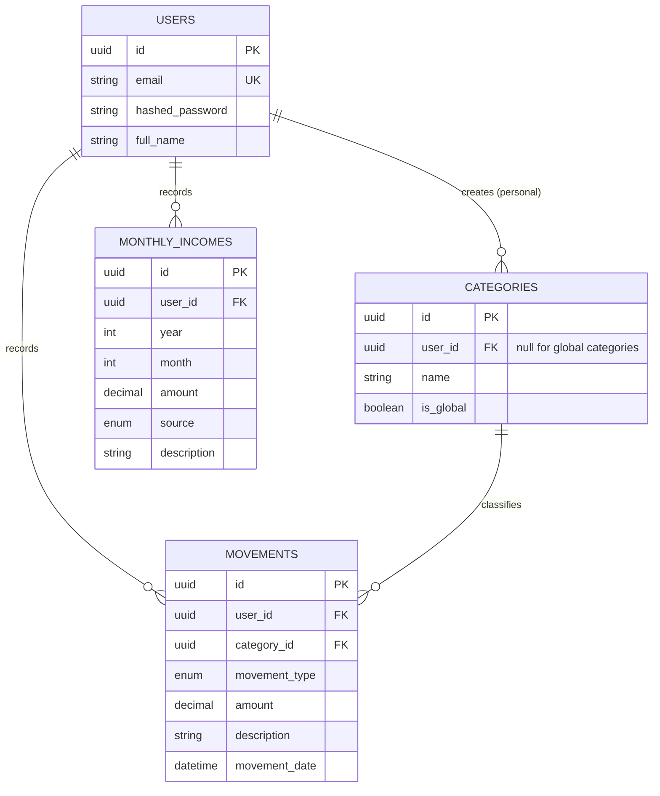

# Kesef — Personal Finance App

A multi-user web app to track personal expenses and monthly income, and to see where the money goes: how much came in, how much went out and which categories took the biggest share.

Kesef is a portfolio project built module by module to practice real-world full-stack architecture: JWT authentication, a layered backend, database migrations, automated tests, rate limiting, a typed React frontend and continuous deployment from `main`.

**Live demo:** [kesef-manage-finances-app-nine.vercel.app](https://kesef-manage-finances-app-nine.vercel.app) · **API docs:** [Swagger UI](https://kesef-manage-finances-app-production.up.railway.app/docs)

## Features

- **Accounts.** Register and log in with email and password. Every user only ever sees their own data.
- **Categories.** *Global* categories shared by everyone (read-only) and *personal* categories each user creates.
- **Movements.** Expenses with amount, type, category, description and date. Filter by type, category and date range.
- **Monthly income.** Income entries by year, month and source; a month can have as many entries as needed.
- **Balance.** Income, expenses, difference and expense breakdown by category, for one month, several months or a whole year.
- **Protection.** Rate limiting on every endpoint, stricter on registration and login.
- **Frontend.** Dashboard with skeleton loaders, light and dark themes, toast feedback, live amount formatting and automatic session handling.

## Tech stack

| Layer | Technology |
| --- | --- |
| Backend | Python, FastAPI, Uvicorn, SQLAlchemy 2.x, Alembic, Pydantic v2 |
| Auth and protection | JWT (python-jose), bcrypt, slowapi |
| Database | PostgreSQL (Neon) |
| Frontend | React 19, TypeScript, Vite, React Compiler, OXLint |
| Frontend libraries | Tailwind CSS v4, React Router, TanStack Query v5, Axios, React Hook Form |
| Testing | pytest, FastAPI `TestClient` |
| Hosting | Railway (API), Vercel (frontend), Neon (database) |

## Repository layout

```
.
├── backend/
│   ├── app/
│   │   ├── api/          # routers and dependencies (auth, categories, movements, incomes, balance)
│   │   ├── core/         # settings, security, domain exceptions, rate limiting
│   │   ├── db/           # engine, session, declarative base
│   │   ├── models/       # SQLAlchemy models
│   │   ├── schemas/      # Pydantic schemas (API input and output)
│   │   ├── services/     # business logic (balance, category deletion)
│   │   └── main.py
│   ├── alembic/          # migrations
│   ├── scripts/          # secret key generator, global categories seed
│   └── tests/
└── frontend/
    └── src/
        ├── api/          # Axios client, API types, error handling
        ├── app/          # router, providers, layouts, navigation
        ├── components/ui # design-system components (Button, Modal, Toast, ...)
        ├── features/     # one folder per module: auth, balance, movements, incomes, categories
        ├── hooks/        # shared hooks (theme)
        ├── lib/          # formatting and date helpers
        └── pages/
```

## Architecture

### Backend

The code is split into layers so each piece has one job:

- **Routers** receive the request, validate it with Pydantic schemas and return the response.
- **Services** hold business logic that doesn't depend on HTTP (the balance calculation, reassigning movements when a category is deleted). They raise domain exceptions that routers translate into HTTP errors.
- **Models** map the tables; **schemas** define what goes in and out of the API, so database models are never exposed directly.

### Frontend

- **Feature folders.** Each module (movements, incomes, categories, balance) owns its API calls, React Query hooks, components and utilities.
- **Server state with TanStack Query.** Mutations invalidate the related queries; the whole cache is cleared on logout or session expiry so data never leaks between users.
- **Design tokens.** Colors are semantic tokens (`bg-surface`, `text-content`, `text-expense`, ...) that the dark theme overrides, so components never hardcode colors.
- **Session handling.** An Axios interceptor attaches the JWT and, when a request made with the current token returns `401`, clears the session and sends the user back to login.

## Data model

All primary keys are UUIDs generated by PostgreSQL.



- `movement_type`: `COMPRA`, `TRANSFERENCIA`, `RETIRO`, `PAGO`, `OTRO`
- `source` (income): `SALARIO`, `FREELANCE`, `CONSIGNACIONES`, `OTROS`
- Deleting a personal category reassigns its movements to the global category **Otros** in the same transaction.

## API overview

Interactive documentation is generated by FastAPI at `/docs` (Swagger UI), `/redoc` and `/openapi.json`.

| Resource | Endpoints |
| --- | --- |
| Auth | `POST /register`, `POST /login` (returns a JWT) |
| Categories | `POST/GET /categories`, `GET/PUT/DELETE /categories/{id}` |
| Movements | `POST/GET /movements`, `GET/PUT/DELETE /movements/{id}` |
| Monthly incomes | `POST/GET /monthly_incomes`, `GET/PUT/DELETE /monthly_incomes/{id}` |
| Balance | `GET /balance?year=2026&month=9` |
| Health | `GET /health` |

Every endpoint except `/register`, `/login` and `/health` requires `Authorization: Bearer <token>`.

**Filters** (repeat a key to send several values):

- `GET /movements`: `movement_type`, `category_id`, `start_date`, `end_date`
- `GET /monthly_incomes`: `year`, `month`
- `GET /balance`: `year` (required), `month`. Without `month`, it returns every month of the year with data.

**Conventions for API consumers**

- Updates (`PUT`) are partial: send only the fields to change.
- Amounts are strings (`"150000.00"`) so no precision is lost. They allow up to 12 digits and 2 decimals.
- Datetimes are stored in UTC; clients convert to the user's local time zone.
- Errors come as `{"detail": "..."}`. Status codes: `400` business rule, `401` missing or invalid token, `404` not found or owned by another user, `409` duplicate category, `422` validation, `429` rate limit.

**Rate limits.** Public endpoints are limited per IP (`/register` 5/hour, `/login` 5/minute). Authenticated endpoints are limited per user, taken from the JWT (60/min reads, 30/min writes, 10/min category deletion). Counters live in memory, so a single process is assumed; several instances would need a shared store such as Redis. Behind a reverse proxy, run Uvicorn with `--proxy-headers` so the real client IP is used.

## Getting started

### Prerequisites

- Python 3.12 or newer
- Node.js 20 or newer
- A PostgreSQL database (a free [Neon](https://neon.tech) project works well)

### Backend

```bash
cd backend
python -m venv .venv
source .venv/bin/activate          # Windows (PowerShell): .venv\Scripts\Activate.ps1
pip install -r requirements.txt
pip install -r requirements-dev.txt   # test dependencies
cp .env.example .env
```

Fill in `.env`:

| Variable | Description | Default |
| --- | --- | --- |
| `DATABASE_URL` | PostgreSQL connection string | required |
| `SECRET_KEY` | Secret used to sign JWTs | required |
| `ALGORITHM` | JWT algorithm | `HS256` |
| `ACCESS_TOKEN_EXPIRE_MINUTES` | Token lifetime | `30` |
| `CORS_ORIGINS` | Allowed frontend origins, comma-separated | `http://localhost:5173` |

Generate a secure key with `python scripts/generate_secret_key.py --bytes 48`, then:

```bash
alembic upgrade head                      # create the tables
python -m scripts.seed_global_categories  # load global categories (required, includes "Otros")
uvicorn app.main:app --reload
```

The API runs at `http://localhost:8000` and its documentation at `http://localhost:8000/docs`.

### Frontend

```bash
cd frontend
npm install
cp .env.example .env     # VITE_API_URL=http://localhost:8000
npm run dev
```

The app runs at `http://localhost:5173`. Other scripts: `npm run build`, `npm run lint`.

`VITE_*` variables are embedded in the bundle at build time, so they must never contain secrets.

## Testing

The backend suite runs end to end through FastAPI's `TestClient` against a real PostgreSQL database.

> ⚠️ **Use a separate database for tests.** The suite creates the tables at startup, empties them after every test and drops them at the end.

Put the test database connection string in `backend/.env.test` (`DATABASE_URL=...`), then:

```bash
cd backend
pytest -v
```

It has one file per module (auth, categories, movements, incomes, balance, rate limiting) and covers validation errors, data isolation between users, filters, partial updates, balance correctness and `429` responses.

## Deployment

Both services deploy automatically on every push to `main`.

| Service | Platform | Configuration |
| --- | --- | --- |
| API | Railway | Root directory `backend`. Pre-deploy: `alembic upgrade head`. Start: `uvicorn app.main:app --host 0.0.0.0 --port $PORT --proxy-headers --forwarded-allow-ips="*"` |
| Frontend | Vercel | Root directory `frontend`, Vite preset, env `VITE_API_URL` pointing to the API. `vercel.json` rewrites all routes to `index.html` for client-side routing. |
| Database | Neon | A separate project or branch for production. |

Production variables on Railway: `DATABASE_URL`, `SECRET_KEY` and `CORS_ORIGINS` (the frontend URL, without a trailing slash). Run the global categories seed once against the production database.

## Contributing

Work happens on feature branches (`feature/<module-name>`) and reaches `main` through a Pull Request.