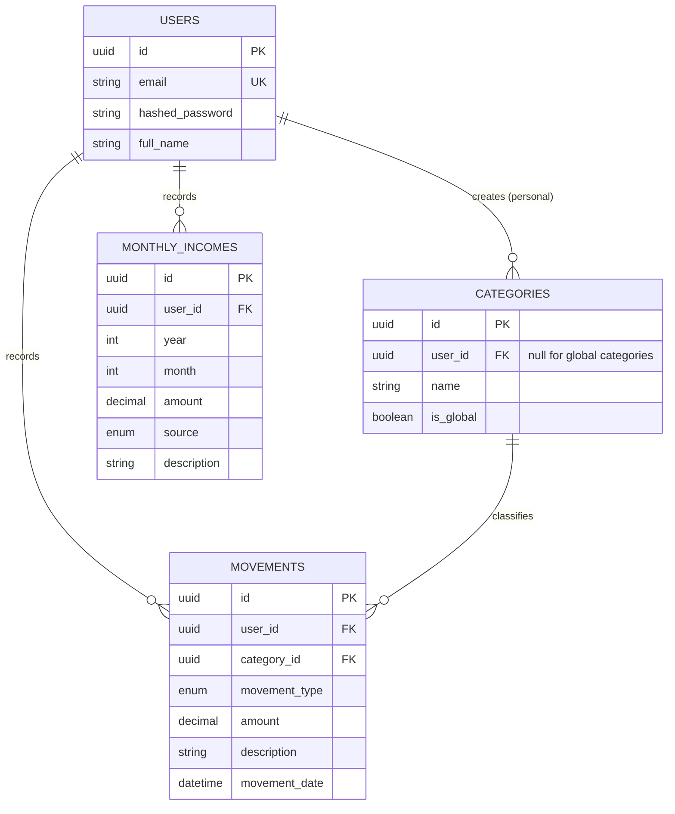

# Kesef — Personal Finance API

A multi-user REST API for tracking personal expenses and monthly income, and for getting a clear picture of where the money goes: how much came in, how much went out, and which categories took the biggest share.

Kesef is a portfolio project built module by module to practice real-world backend architecture: authentication, a layered design, database migrations, automated tests, rate limiting and API documentation. The backend is complete; a React frontend and deployment are the next steps.

## What it does

- **Accounts and authentication.** Users register and log in with email and password and receive a JWT. Every user only ever sees their own data.
- **Categories.** Expenses are organized into categories. There are *global* categories shared by everyone and *personal* categories each user creates for themselves.
- **Movements.** Record expenses with an amount, a type, a category, an optional description and a date. Filter them by type, category and date range.
- **Monthly income.** Record income by year, month and source. A month can have as many income entries as needed (salary, freelance work, and so on).
- **Balance.** Get the balance of a single month, several months, or an entire year: total income, total expenses, the difference between them, and the expense breakdown by category.
- **Protection.** Rate limiting on every endpoint, with stricter limits on registration and login.

## Tech stack

| Layer | Technology |
| --- | --- |
| Language / framework | Python, FastAPI, Uvicorn |
| Database | PostgreSQL (hosted on Neon) |
| ORM / migrations | SQLAlchemy 2.x, Alembic |
| Validation / settings | Pydantic v2, pydantic-settings |
| Authentication | JWT (python-jose), bcrypt |
| Rate limiting | slowapi |
| Testing | pytest, FastAPI `TestClient` |
| API documentation | OpenAPI (Swagger UI and ReDoc, generated by FastAPI) |

## How it is organized

The code is split into layers so each piece has one job:

- **Routers** receive the HTTP request, validate it with Pydantic schemas and return the response.
- **Services** hold business logic that doesn't depend on HTTP (for example, the balance calculation or reassigning movements when a category is deleted). They raise domain exceptions that the routers translate into HTTP errors.
- **Models** map the database tables with SQLAlchemy.
- **Schemas** define what goes in and out of the API, so the database models are never exposed directly (a user's password hash, for example, can never leak).

## Data model

All primary keys are UUIDs generated by PostgreSQL, and every table has `created_at` and `updated_at` timestamps.



| Table | Purpose |
| --- | --- |
| `users` | Registered accounts. The email is unique and the password is stored only as a bcrypt hash. |
| `categories` | Expense categories. A category with `is_global = true` has no owner and is visible to everyone (read-only); otherwise it belongs to one user. |
| `movements` | Individual expenses. Each one belongs to a user and to a category (personal or global). |
| `monthly_incomes` | Income entries identified by year and month, with a source. |

Enums:

- `movement_type`: `COMPRA`, `TRANSFERENCIA`, `RETIRO`, `PAGO`, `OTRO`
- `source` (income): `SALARIO`, `FREELANCE`, `CONSIGNACIONES`, `OTROS`

When a personal category is deleted, its movements are automatically reassigned to the global category **Otros** in the same transaction, so no data is lost.

## Authentication

1. `POST /register` creates the account.
2. `POST /login` receives the credentials as JSON and returns a token:

   ```json
   { "access_token": "<jwt>", "token_type": "bearer" }
   ```

3. Every other endpoint (except `/health`) requires the header:

   ```
   Authorization: Bearer <access_token>
   ```

Tokens are signed with `SECRET_KEY` and expire after 30 minutes by default. A resource that belongs to another user always answers `404`, so the API never reveals whether it exists.

## API reference

### Interactive documentation (Swagger)

With the server running, the full API documentation is generated automatically:

| URL | What it is |
| --- | --- |
| `http://localhost:8000/docs` | Swagger UI: browse every endpoint, see request/response schemas and examples, and try requests from the browser |
| `http://localhost:8000/redoc` | ReDoc: a read-only, single-page view of the same documentation |
| `http://localhost:8000/openapi.json` | The raw OpenAPI schema, useful to generate clients |

To try authenticated endpoints from Swagger UI:

1. Open `POST /register` and create a user (the request body already has an example).
2. Open `POST /login` and execute it with the same credentials.
3. Copy the `access_token` from the response.
4. Click **Authorize** at the top right, paste the token and confirm.

From then on, every request you make from Swagger UI is sent as that user.

### Endpoints

| Method | Path | Description | Rate limit |
| --- | --- | --- | --- |
| GET | `/health` | Server and database health check | none |
| POST | `/register` | Create a user | 5 / hour per IP |
| POST | `/login` | Get an access token | 5 / minute per IP |
| POST | `/categories` | Create a personal category | 30 / min per user |
| GET | `/categories` | List personal + global categories (optional `?name=` search, case-insensitive) | 60 / min per user |
| GET | `/categories/{id}` | Get one category | 60 / min per user |
| PUT | `/categories/{id}` | Rename a personal category | 30 / min per user |
| DELETE | `/categories/{id}` | Delete a personal category (movements move to "Otros") | 10 / min per user |
| POST | `/movements` | Create a movement | 30 / min per user |
| GET | `/movements` | List movements (with filters) | 60 / min per user |
| GET | `/movements/{id}` | Get one movement | 60 / min per user |
| PUT | `/movements/{id}` | Partial update | 30 / min per user |
| DELETE | `/movements/{id}` | Delete a movement | 30 / min per user |
| POST | `/monthly_incomes` | Create an income entry | 30 / min per user |
| GET | `/monthly_incomes` | List income entries (with filters) | 60 / min per user |
| GET | `/monthly_incomes/{id}` | Get one income entry | 60 / min per user |
| PUT | `/monthly_incomes/{id}` | Partial update | 30 / min per user |
| DELETE | `/monthly_incomes/{id}` | Delete an income entry | 30 / min per user |
| GET | `/balance` | Monthly or yearly balance | 60 / min per user |

Updates (`PUT`) are partial: send only the fields you want to change.

### Filters

- **`GET /movements`** — `movement_type` (repeatable), `category_id` (repeatable), `start_date` and `end_date` (can be used together or separately).
- **`GET /monthly_incomes`** — `year` and `month` (repeatable).
- **`GET /balance`** — `year` (required) and `month` (repeatable, 1–12).

Repeatable parameters are sent by repeating the key:

```
GET /movements?category_id=<uuid1>&category_id=<uuid2>&movement_type=COMPRA
GET /balance?year=2026&month=9&month=10
```

### Example: register, log in, create a movement

```bash
# 1. Create an account
curl -X POST http://localhost:8000/register \
  -H "Content-Type: application/json" \
  -d '{"email": "me@example.com", "password": "my-password-123", "full_name": "Me"}'

# 2. Log in and copy the access_token from the response
curl -X POST http://localhost:8000/login \
  -H "Content-Type: application/json" \
  -d '{"email": "me@example.com", "password": "my-password-123"}'

# 3. List categories to get a category id
curl http://localhost:8000/categories -H "Authorization: Bearer <access_token>"

# 4. Record an expense
curl -X POST http://localhost:8000/movements \
  -H "Authorization: Bearer <access_token>" \
  -H "Content-Type: application/json" \
  -d '{
        "category_id": "<category-id>",
        "movement_type": "COMPRA",
        "amount": "150000.00",
        "description": "Groceries"
      }'
```

### Example: balance

`GET /balance?year=2026&month=9` returns a list with one entry per month:

```json
[
  {
    "year": 2026,
    "month": 9,
    "total_income": "4500000.00",
    "total_expenses": "650000.00",
    "balance": "3850000.00",
    "expenses_by_category": [
      { "category_id": "…", "category_name": "Vehículo", "total": "500000.00" },
      { "category_id": "…", "category_name": "Otros", "total": "150000.00" }
    ]
  }
]
```

- The response is always a list, and the category breakdown is sorted from highest to lowest expense.
- Without `month`, the endpoint returns every month of the year that has income or expenses, most recent first.
- With an explicit `month` that has no data, that month is returned with zeros.

### Error responses

| Status | Meaning |
| --- | --- |
| `400` | Email already registered, or a business rule violation |
| `401` | Missing, invalid or expired token; wrong credentials on login |
| `404` | Resource not found (or owned by another user) |
| `409` | A personal category with that name already exists |
| `422` | Validation error (invalid enum value, month outside 1–12, missing field…) |
| `429` | Rate limit exceeded |
| `500` | Unexpected server error (details are logged, never exposed) |

Errors come as `{"detail": "..."}`; rate-limit errors come as `{"error": "Rate limit exceeded: ..."}`.

### Notes for API consumers

- **Amounts are strings** (`"150000.00"`) so no precision is lost; send and parse them as decimals.
- **Dates are stored as received**, with no time zone conversion. Clients are responsible for converting to and from the user's local time zone.
- **Input limits:** amounts have up to 12 digits with 2 decimals; income `year` must be between 2000 and 2100.

## Rate limiting

Limits are enforced with [slowapi](https://github.com/laurentS/slowapi):

- **Public endpoints** (`/register`, `/login`) are limited **per IP address**, which slows down brute-force attempts.
- **Authenticated endpoints** are limited **per user** (taken from the JWT), so two users behind the same IP don't block each other. If the token is missing or invalid, the limit falls back to the IP.
- `/health` is not limited, so health checks keep working.

Counters are kept in memory, which is fine for a single process. Running several workers or instances behind a load balancer requires a shared store such as Redis (`Limiter(storage_uri="redis://…")`), and running behind a reverse proxy requires forwarding the real client IP (`--proxy-headers`).

## Getting started

### Prerequisites

- Python 3 (developed with 3.13)
- A PostgreSQL database (a free [Neon](https://neon.tech) project works well)

### Setup

```bash
git clone <your-repository-url>
cd <repository>/backend

python -m venv .venv
source .venv/bin/activate          # Windows: .venv\Scripts\activate

pip install -r requirements.txt
pip install -r requirements-dev.txt   # test dependencies
```

Create a `.env` file from the provided `env.example`:

```env
DATABASE_URL=         # PostgreSQL connection string
SECRET_KEY=           # secret used to sign the JWTs
ALGORITHM=HS256
ACCESS_TOKEN_EXPIRE_MINUTES=30
```

Generate a secure `SECRET_KEY`:

```bash
python scripts/generate_secret_key.py --bytes 48
```

Apply the database migrations:

```bash
alembic upgrade head
```

Load the global categories (required, since deleting a category reassigns its movements to **Otros**):

```bash
python -m scripts.seed_global_categories
```

Start the server:

```bash
uvicorn app.main:app --reload
```

The API is now at `http://localhost:8000` and the documentation at `http://localhost:8000/docs`.

### Useful commands

| Task | Command |
| --- | --- |
| Create a migration after editing a model | `alembic revision --autogenerate -m "message"` |
| Apply migrations | `alembic upgrade head` |
| Show the current migration | `alembic current` |

## Testing

The test suite uses pytest and exercises the API end to end through FastAPI's `TestClient`, against a real PostgreSQL database.

> ⚠️ **Use a separate database for tests.** The suite creates all tables when it starts, empties them after every test and drops them at the end. Never point it at a database with real data.

Create a `.env.test` file with the connection string of a dedicated test database:

```env
DATABASE_URL=         # a different database from the one in .env
```

```bash
pytest -v                                   # whole suite
pytest tests/test_balance.py -v             # one file
pytest tests/test_balance.py::test_monthly_balance_totals -v   # one test
pytest --lf                                 # re-run only the last failures
```

The suite has one file per module (auth, categories, movements, monthly incomes, balance, rate limiting) and covers, among other things:

- Successful creation and validation errors (invalid enums, out-of-range months and years, missing fields).
- Data isolation between users: nobody can read, edit or delete another user's data.
- Filters, always checked with data that must match *and* data that must be excluded.
- Partial updates: `updated_at` changes while `created_at` stays the same.
- Balance correctness: exact totals, breakdown by category, month boundaries, monthly and yearly views.
- Rate limiting: `429` on login, registration and an authenticated endpoint, with independent counters per user.
- Generation of the OpenAPI schema.

Rate limiting is switched off for the whole suite by a fixture so tests don't interfere with each other, and switched on only in the tests that verify it.

## Roadmap

- [x] Authentication with JWT
- [x] Categories, movements and monthly income management
- [x] Monthly and yearly balance
- [x] Automated test suite
- [x] Rate limiting
- [x] API documentation
- [ ] React frontend